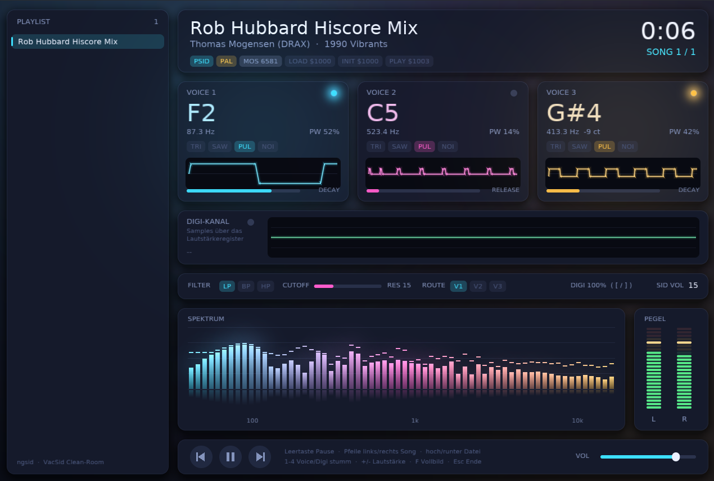
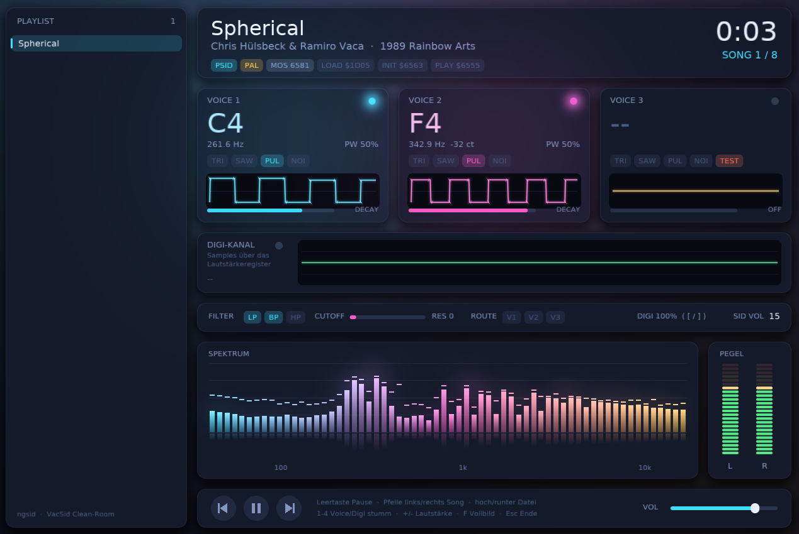

# ngSid

*NextGenSid, a modern SID player with the VacSid sound.*

**A Linux/POSIX SID player that stands on the shoulders of VacSid, the finest SID player ever written.**

ngSid is based on **VacSid** by **Oliver Blasnik ("R0M" / Vacuum)**, the legendary DOS SID player.
VacSid was ahead of its time: a tiny, fast, brilliantly engineered player with a
sound that many of us still prefer over everything that came after. Its mixer, its envelope handling and its
unmistakable character are the reason this project exists. If you like how ngSid sounds, the credit goes to Oliver.

This project takes the VacSid sound and brings it to modern systems, then refines it:

- the synthesis core reproduces the algorithms and quirks of VacSid 0.88 (integer oscillator, OR-combined
  waveforms, table-driven volume, slew-limiting filter, block-wise mixing, pseudo stereo),
- it is wrapped in a complete 6510 / C64 environment so real PSID and RSID files run unmodified,
- and it has been modernised and extended in many places (see below).

It is an independent re-implementation. It contains **no code and no binaries from VacSid**; it was written from
observation of how the original behaves. The original author is not affiliated with this project and has not
endorsed it. If you are Oliver and have concerns, please open an issue.

  
  

## Features

- **Full 6510 CPU** with a minimal KERNAL/CIA/VIC environment: PSID v1-v4 and RSID, VBI and CIA-timed play routines
  (including tunes that reprogram the CIA timer, such as multi-speed players).
- **VacSid-faithful synthesis**: 3 voices, ADSR, pulse / saw / triangle / noise, sync and ring, the original
  filter model, the auto gain limiter and the pseudo stereo image.
- **Digi support**: NMI-driven 4-bit samples through `$D418`, and the volume-register "bursts" used by
  Martin Galway's tunes, including per-sample volume modulation of the voices as on the real chip.
- **Smart limiter**: switches itself on only for tunes with digi, so synthetic drum tunes do not pump
  (`--limiter` / `--no-limiter` to force).
- **Online HVSC browser**: browse the High Voltage SID Collection by folder (musicians, games, demos) straight from a
  public mirror and play tunes without downloading the collection. Only the tunes you play are cached in
  `~/.cache/ngsid`. Needs the `curl` program; set `NGSID_HVSC_MIRROR` to use another mirror.
- **OpenGL GUI**: playlist, drag and drop, per-voice cards with note, frequency, scope and
  envelope, a separate digi channel display, filter strip, spectrum and VU meters, fullscreen.
- Sample-accurate SID register timing, adjustable output rate up to 400 kHz internal.
- Unit tests for the CPU, the C64 environment, PSID handling and the synthesizer.

## Build

Requirements: a C99 compiler, `make`, SDL2 (development files) and `pkg-config`.

    make                 # builds ./ngSid
    make check           # runs the self-tests (no SDL2 needed)
    sudo make install    # optional, installs to /usr/local/bin (PREFIX=... to change)

## Use

    ./ngSid tune.sid          # or a folder, or drag and drop files onto the window
    ./ngSid -s 2 tune.sid     # start with song 2

Keys: `B` HVSC online browser (`Up/Down` select, `Enter` open/play, `Backspace` folder up), `Space` pause, `Left/Right` song, `Up/Down` file, `1`-`3` mute voices, `4` mute digi, `+`/`-` volume,
`[` / `]` digi gain, `R` restart, `F` / `F11` fullscreen, `Esc` quit. Mouse: click a voice card to mute it,
click the playlist, drag the volume bar.

Options:

| Option | Meaning |
|---|---|
| `-s N` | start song |
| `--pal`, `--ntsc` | override the clock |
| `--rate N` | sample rate |
| `--exact-clock` | use the exact C64 clock instead of VacSid's slightly detuned one |
| `--limiter`, `--no-limiter` | force the limiter on or off (default: automatic, on for digi tunes) |
| `--no-vol-burst` | disable detection of volume-register digi bursts |
| `--digi-gain N` | digi level in percent |
| `--digi-wrap` | 8-bit wrap-around of the digi sum (not recommended) |
| `--filter-clamp` | clamp filter overflow instead of wrapping |
| `--vbi` | force VBI timing for CIA-timed tunes |

SID files are not included. The best source is the High Voltage SID Collection (<https://hvsc.de>).

## Status and limits

Not implemented yet: PlaySID sample registers (`$D41D-$D43F`), a second SID chip, and a few exotic digi
techniques. Behaviour was verified against a real C64 for several tunes; please report tunes that sound
different from the real machine.

## Credits

- **Oliver Blasnik ("R0M" / Vacuum)**: VacSid, the player this project is based on.
- DejaVu Sans (Bitstream Vera licence) is baked into `gui/font_data.h` for the GUI.
- The High Voltage SID Collection crew, for keeping the music alive.

## License

GPL-3.0-or-later. Everyone may use, study, change and share it. See [`LICENSE`](LICENSE).
